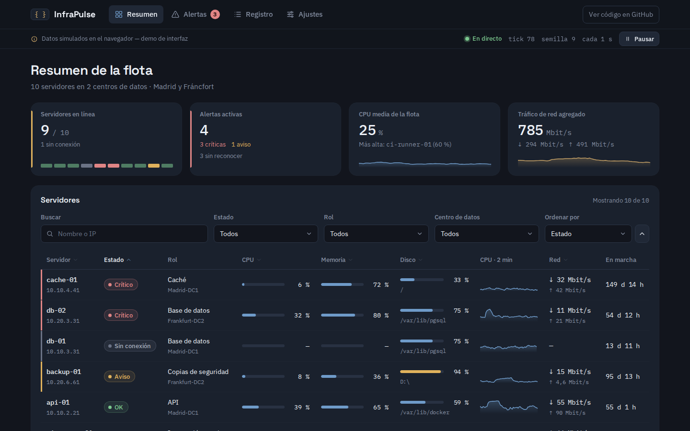
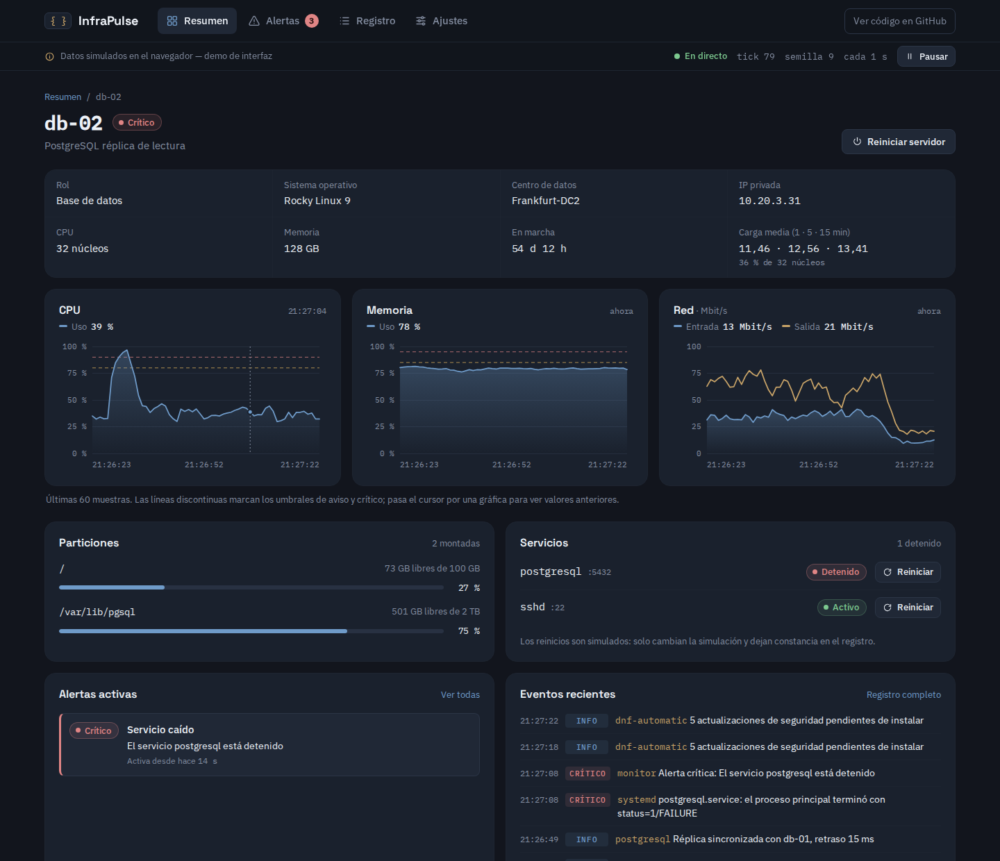
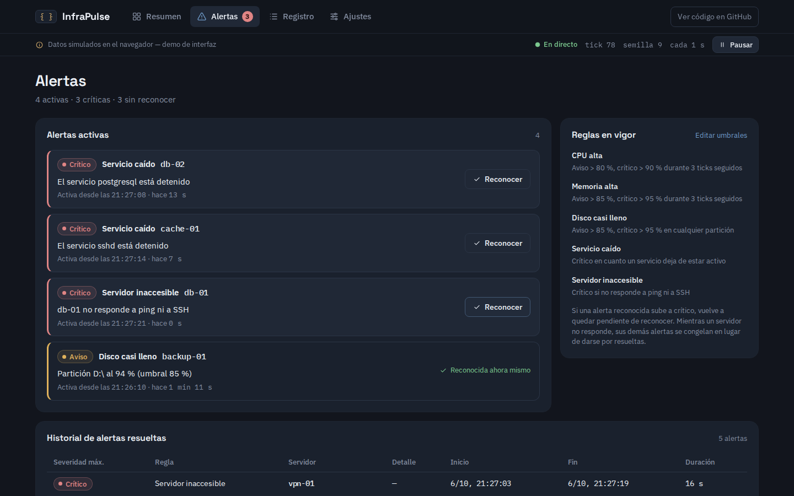
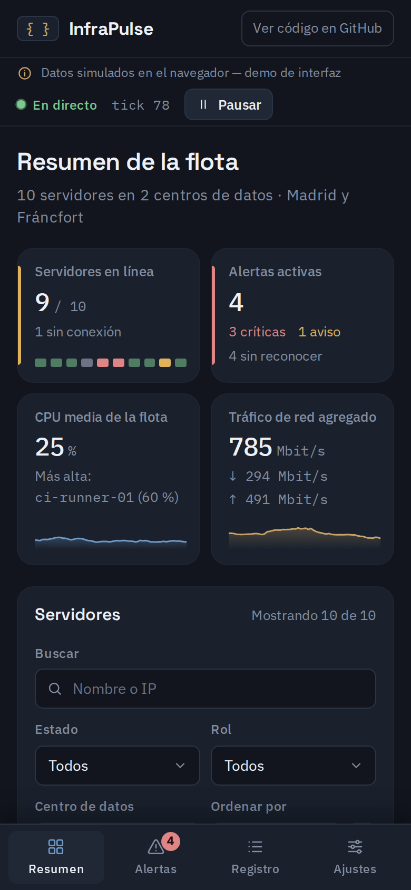

# InfraPulse

Panel de monitorización de una flota de servidores, al estilo de un centro de operaciones (NOC), hecho con **React 19 + TypeScript + Vite**.

Muestra en tiempo real el estado de 10 servidores (CPU, memoria, red, discos, servicios), evalúa reglas de alerta, guarda un registro de eventos y permite lanzar acciones de operador como reiniciar un servicio.

> **Todos los datos son simulados en el navegador.** No hay servidores reales ni backend: la flota, las métricas, los incidentes y las acciones (reinicios, reconocimientos) solo existen en la simulación, y la propia interfaz lo indica en todo momento.

**Demo:** https://miguelangel-alonso.netlify.app/demo-infrapulse/



| Detalle de servidor | Alertas |
| --- | --- |
|  |  |

<p align="center"></p>

## Funcionalidades

- **Resumen** (`#/`): indicadores de servidores en línea, alertas activas por severidad, CPU media y tráfico agregado (con mini-gráficas); filtros por estado, rol, centro de datos y texto (nombre o IP); tabla ordenable por columnas en escritorio y tarjetas en móvil.
- **Detalle de servidor** (`#/servidor/web-01`): metadatos (SO, centro de datos, IP, núcleos, RAM, tiempo en marcha, carga media 1/5/15 min), gráficas en vivo de CPU, memoria y red de los últimos 60 ticks con umbrales y lectura al pasar el cursor, particiones, servicios con botón **Reiniciar** y eventos recientes. Reinicio del servidor con confirmación en dos pasos.
- **Alertas** (`#/alertas`): alertas activas ordenadas por urgencia con botón **Reconocer**, resumen de las reglas en vigor e historial de alertas resueltas con su duración.
- **Registro** (`#/registro`): flujo de eventos con filtro por nivel y por texto, pausa (con contador de eventos nuevos) y **exportación a CSV**.
- **Ajustes** (`#/ajustes`): intervalo de actualización, umbrales de alerta y semilla, validados y guardados en `localStorage`; reinicio de la simulación.
- Pausar y reanudar la simulación desde la barra superior.
- Interfaz en español: números con `Intl.NumberFormat('es-ES')` y duraciones legibles ("3 min 12 s", "4 d 6 h").

## Cómo funciona la simulación

Cada *tick* (por defecto cada 2 s) se ejecuta una función pura `step(estado, ahora, umbrales)`:

1. **Métricas**: CPU, RAM y red siguen un *paseo aleatorio acotado con vuelta a la media*: cada tick el valor se acerca un poco a la referencia de su rol (un servidor web no se comporta como una base de datos) y se le suma ruido. Los valores siempre quedan entre 0 y 100 %.
2. **Carga media**: medias exponenciales con distinta inercia para 1, 5 y 15 minutos, como hace el kernel.
3. **Trabajos periódicos**: el runner de CI ejecuta builds y el servidor de copias lanza trabajos que disparan CPU y tráfico de entrada.
4. **Discos**: las particiones de copias y bases de datos se llenan poco a poco; al llegar a su límite se ejecuta una limpieza automática (política de retención, VACUUM, `docker system prune`, logrotate…).
5. **Incidentes aleatorios** (como mucho 3 a la vez): pico de CPU, caída de un servicio, crecimiento anómalo de un disco o servidor que deja de responder. Se resuelven solos con el tiempo o con una acción del operador.
6. **Reglas de alerta** sobre el nuevo estado (ver abajo) y entradas en el registro.

El generador pseudoaleatorio es **mulberry32** con semilla. Su estado (un entero de 32 bits) viaja dentro del estado de la simulación, así que con la misma semilla el resultado es idéntico: `index.html?seed=42` reproduce siempre la misma secuencia. Sin semilla se usa una basada en la hora. Al arrancar se simulan 60 ticks "hacia atrás" para que las gráficas tengan datos desde el primer momento.

## Reglas de alerta

| Regla | Condición (valores por defecto, editables) | Severidad |
| --- | --- | --- |
| CPU alta | > 80 % / > 90 % durante **3 ticks consecutivos** | aviso / crítico |
| Memoria alta | > 85 % / > 95 % durante 3 ticks consecutivos | aviso / crítico |
| Disco casi lleno | > 85 % / > 95 % en cualquier partición | aviso / crítico |
| Servicio caído | el servicio no está activo | crítico |
| Servidor inaccesible | no responde a ping ni SSH | crítico |

- La exigencia de ticks consecutivos evita falsos positivos por picos puntuales; un solo tick por debajo reinicia la racha.
- Una alerta puede **escalar** de aviso a crítico (misma alerta, se conserva la hora de inicio). Si estaba reconocida, vuelve a quedar pendiente.
- Cuando la condición desaparece, la alerta se **resuelve** y pasa al historial con su duración.
- Mientras un servidor no responde, sus otras alertas se **congelan** (como un check *UNKNOWN* en Nagios) en vez de darse por resueltas. Un reinicio pedido por el operador no genera alerta de conectividad.

## Arquitectura

```
src/
├── main.tsx                 # Punto de entrada: proveedores de ajustes y simulación
├── App.tsx                  # Cabecera, enrutado por hash y región aria-live
├── sim/                     # Dominio y simulación (TypeScript puro, sin React)
│   ├── types.ts             # Servidor, métricas, alertas, eventos, estado
│   ├── fleet.ts             # Inventario de la flota y perfil de cada rol
│   ├── simulation.ts        # Reducer puro: tick, acciones del operador, reset
│   ├── alerts.ts            # Motor de reglas: rachas, escalado y resolución
│   ├── routine.ts           # Eventos rutinarios del registro (cron, sshd…)
│   ├── selectors.ts         # Datos derivados: estado de cada servidor, KPIs
│   ├── serverQuery.ts       # Filtrado y ordenación de servidores
│   ├── logQuery.ts          # Filtrado del registro y exportación CSV
│   ├── settings.ts          # Ajustes por defecto, validación y saneado
│   └── store.ts             # Store mínimo para useSyncExternalStore
├── context/                 # Proveedores de React (ajustes y simulación)
├── hooks/                   # useInterval, useLocalStorage, useHashRoute, useElementWidth
├── lib/                     # PRNG, formateadores es-ES, rutas, CSV, localStorage seguro
├── components/
│   ├── charts/              # Sparkline y TimeSeriesChart en SVG + geometría (paths.ts)
│   └── …                    # Barra superior, píldoras de estado, barras de uso, iconos
├── pages/                   # Resumen, Servidor, Alertas, Registro, Ajustes
├── styles/global.css        # Hoja de estilos única con variables CSS
└── test/fixtures.ts         # Utilidades para los tests
```

**Flujo de datos**: `SimulationProvider` crea un store con el estado inicial y un `useInterval` despacha `{ type: 'tick' }` cada N segundos. El reducer (`simulationReducer`) devuelve un estado nuevo e inmutable y los componentes lo leen con `useSyncExternalStore`. Las acciones del operador (reiniciar un servicio, reconocer una alerta, pausar) son otras acciones del mismo reducer. Los ajustes viven aparte, en un contexto sincronizado con `localStorage`.

## Decisiones técnicas

- **Lógica separada de la interfaz**: toda la simulación y las reglas de alerta son funciones puras en `src/sim/`, sin React. Por eso se pueden testear directamente y explicar por separado.
- **Estado con `useSyncExternalStore`** y un store de ~30 líneas en lugar de Redux u otra librería: suficiente para este caso y fácil de seguir.
- **Gráficas propias en SVG** en lugar de una librería: sparkline, gráfica de líneas/área con umbrales, huecos cuando no hay datos y lectura al pasar el cursor. Pesan poco y se controla cada detalle visual. La geometría (`paths.ts`) está testeada.
- **Rutas por hash** (`#/alertas`) con un hook de 10 líneas: funcionan desde cualquier subcarpeta y abriendo el `index.html` directamente, sin configurar el servidor.
- **Build compatible con `file://`**: los navegadores bloquean `<script type="module">` al abrir un HTML con doble clic. Vite genera un único bundle en formato IIFE (`base: './'`, `codeSplitting: false`, sin `modulePreload`) y un pequeño plugin reescribe la etiqueta a `<script defer>` sin `type="module"` ni `crossorigin`. El CSS se emite como fichero aparte para evitar un parpadeo sin estilos.
- **PRNG con semilla** (mulberry32) para que la simulación sea reproducible y los tests deterministas.
- **Validación en dos niveles**: el formulario de ajustes valida rangos y que el aviso sea menor que el crítico; lo leído de `localStorage` se sanea siempre, y si está corrupto se vuelve a los valores por defecto. Todo acceso a `localStorage` va en `try/catch`.
- **CSV para Excel en español**: separador `;`, BOM UTF-8 y fechas ISO 8601.
- **Accesibilidad**: navegación por teclado con `:focus-visible`, enlace "Saltar al contenido", foco al título al cambiar de página, controles etiquetados, `role="meter"` en las barras de uso, `aria-sort` en la tabla, región `aria-live` que anuncia el número de alertas críticas, estados que nunca dependen solo del color y `prefers-reduced-motion`.
- **Responsive** hasta 320 px sin scroll horizontal: tabla en escritorio, tarjetas en móvil y barra de navegación inferior.

## Scripts

Requiere Node.js 22.12 o superior.

```bash
npm install
npm run dev        # servidor de desarrollo
npm test           # tests unitarios (Vitest)
npm run typecheck  # comprobación de tipos (tsc, modo estricto)
npm run build      # typecheck + build de producción en dist/
npm run preview    # sirve dist/ en local
```

El `dist/` generado funciona servido desde cualquier subcarpeta y también abriendo `dist/index.html` con doble clic.

Parámetro útil: `?seed=123` antes del hash (`index.html?seed=123#/alertas`) fija la semilla de la simulación.

## Tests

Los tests cubren la lógica pura: determinismo del PRNG, límites de la simulación (miles de ticks con varias semillas sin salirse de rango), reglas de alerta (ticks consecutivos, escalado, reconocimiento, resolución, congelado sin conexión), acciones del operador, validación de ajustes, formateadores en español, rutas, filtros, CSV y geometría de las gráficas.

## Limitaciones

- Es una demo de interfaz: no se conecta a ningún agente ni API real (Prometheus, Zabbix, etc.).
- El estado de la simulación no se guarda: al recargar se genera de nuevo (igual si la semilla es fija). Solo los ajustes persisten.
- Las tipografías se cargan desde Google Fonts; sin conexión se usan las fuentes del sistema.

## Autor

Miguel Ángel Alonso Valhondo — [LinkedIn](https://www.linkedin.com/in/miguelangel-alonso-valhondo)

Licencia [MIT](LICENSE).
